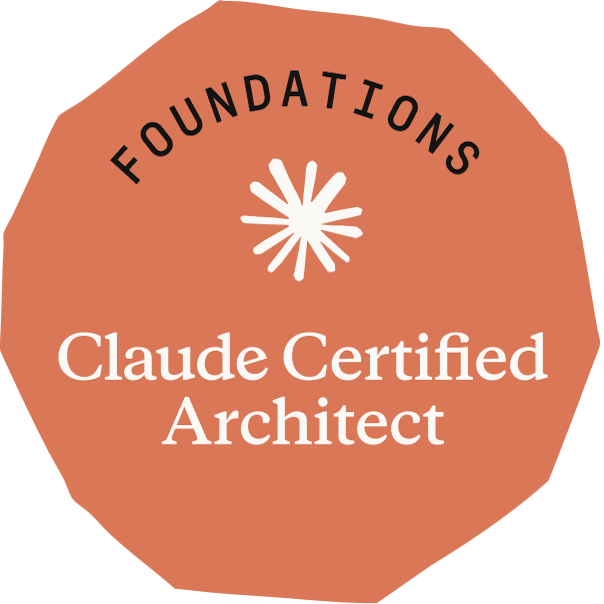
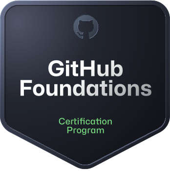

<a href="https://portfolio.elesawy.website">
  <picture>
    <source media="(prefers-color-scheme: dark)" srcset="assets/header-dark.svg">
    
  </picture>
</a>

  <a href="https://portfolio.elesawy.website"><b>Portfolio</b></a> &nbsp;·&nbsp;
  <a href="https://www.linkedin.com/in/AhmedL3swy"><b>LinkedIn</b></a> &nbsp;·&nbsp;
  <a href="mailto:AhmedL3swy@outlook.com"><b>Email</b></a> &nbsp;·&nbsp;
  <a href="https://portfolio.elesawy.website/assets/cv/Ahmed-Elesawy-CV.pdf"><b>CV</b></a>

I build secure, scalable web systems with **ASP.NET Core** and **Angular**, and the **Azure DevOps** pipelines that ship them. I care about performance, security and maintainable code, and I like owning a feature from design to deployment.

- **Now:** Mid-Level Full-Stack .NET Angular Developer at [Alqemam-qTech](https://www.linkedin.com/company/alqemam/). I build synchronization services and Email/SMS notification modules, and I've made our CI/CD faster.
- **Before:** Junior at the same team, building high-security governance solutions on ASP.NET Core, Angular and Oracle. Named **High-Flyer Achiever of 2024**.
- **Exploring:** LLM-powered systems and agents. Recently earned **Claude Certified Architect – Foundations**.
- **Background:** B.Sc. Electronics & Communications Engineering (Excellent), Mansoura University, plus ITI's Professional Web Development & BI Diploma.

## Featured work

<table>
  <tr>
    <td width="50%" valign="top">
      <h3><a href="https://github.com/Price-Pee">PriceBee</a></h3>
      
Price comparison across online stores. I built the multilingual scraping service, Hangfire background jobs, SignalR live notifications and a BotPress chatbot.

      
ASP.NET Core · Angular · SQL Server · FastAPI

      
🥈 <b>2nd place</b>, qTech Hackathon for Delta ITI graduation projects

    </td>
    <td width="50%" valign="top">
      <h3><a href="https://github.com/AhmedL3swy/ResWB-Dehaze">Dehazing for self-driving cars</a></h3>
      
A novel dehazing model that keeps vision clear in bad weather, served through a <a href="https://github.com/AhmedL3swy/dehaze">FastAPI deployment</a>.

      
PyTorch · ONNX · OpenCV · FastAPI

      
🌍 <b>12th worldwide</b> in NTIRE 2023. Featured in the <a href="https://doi.org/10.1109/CVPRW59228.2023.00180">IEEE/CVF CVPRW 2023 challenge report</a>

    </td>
  </tr>
  <tr>
    <td width="50%" valign="top">
      <h3><a href="https://ccar-f.elesawy.website/">CCAR-F Field Guide</a></h3>
      
A study plan for the Claude Certified Architect exam: every task statement with a plain-language summary, decisions to recall and exam traps, translated into Arabic row by row.

      
JavaScript · Cloudflare · <a href="https://github.com/AhmedL3swy/ccar-f">source</a>

    </td>
    <td width="50%" valign="top">
      <h3><a href="https://github.com/AhmedL3swy/Examination-System">Examination System</a></h3>
      
A secure desktop exam platform built database-first, with every data operation going through stored procedures for integrity and speed.

      
.NET · WinForms · SQL Server · Crystal Reports · SSRS

    </td>
  </tr>
</table>

## Stack

| | |
|---|---|
| **Languages** |  |
| **Back end** |  ASP.NET Core (Web API, MVC, Worker Services) · EF Core · Dapper · SignalR · Ocelot · Serilog |
| **Front end** |  |
| **Data** |  SQL Server · Oracle PL/SQL · SSIS · SSAS · SSRS |
| **DevOps & cloud** |  Azure DevOps Pipelines · Application Insights · ELK Stack |
| **AI / ML** |  ONNX · NumPy · Pandas · Claude |

## Certifications

  &nbsp;&nbsp;
  &nbsp;&nbsp;
  

---

Happy to talk .NET, Angular, DevOps or building with AI. <a href="mailto:AhmedL3swy@outlook.com">Say hello</a>.

